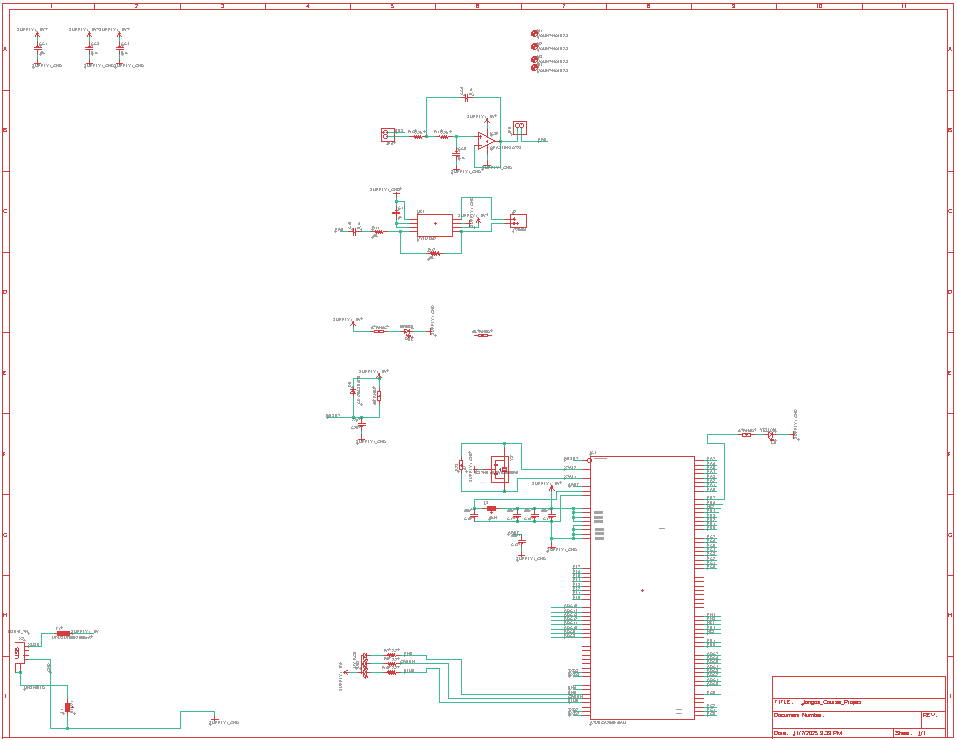
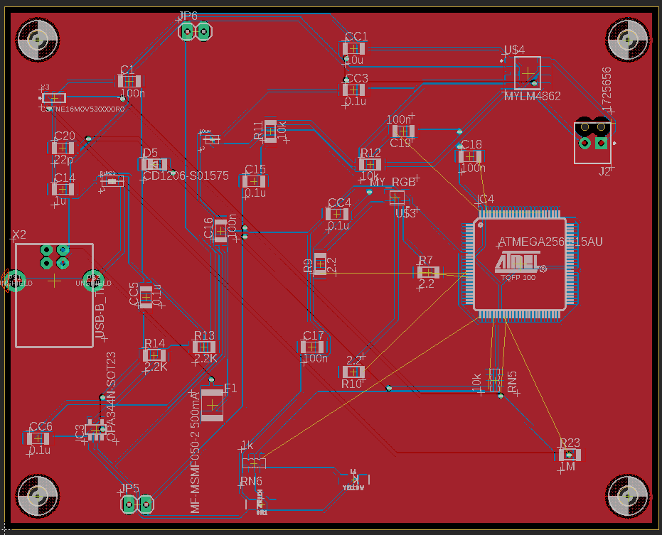

# ATmega2560 Microcontroller Projects

Coursework from CE 351 at Fort Lewis College: a custom ATmega2560 board I
designed in Eagle, and five folders of Arduino-IDE sketches. Most of the
sketches set up the ATmega2560's timers, ADC and USARTs by writing their
registers directly.
The sketches run on Fort Lewis College's ATmega2560 course board, which I
soldered and brought up. Everything here is small and course-sized; each
folder README says what the code does and what is not in the repo.

&nbsp;

## Projects

| Folder | What it is |
| --- | --- |
| [`custom-mega-pcb/`](custom-mega-pcb/README.md) | 2-layer, 160 x 100 mm ATmega2560 board in Eagle 9.6: schematic, board file, Gerbers, drill and pick-and-place files. |
| [`bare-metal-adc-sampler/`](bare-metal-adc-sampler/README.md) | Timer1 starts an ADC conversion every 25 µs (40 kHz). After a threshold trigger the ADC interrupt stores 256 samples, and the main loop estimates the signal frequency from zero crossings. |
| [`ir-link-layer-protocol/`](ir-link-layer-protocol/README.md) | Serial messages over a 38 kHz IR carrier: Timer5 makes the carrier, Timer3 times the bits (2400 baud), USART1 receives. Messages carry source and destination addresses and a checksum. |
| [`interrupt-music-box/`](interrupt-music-box/README.md) | Three timer-interrupt sketches: a tone generator, a song player (Timer1 sets pitch, Timer3 sets note length) and a rhythm-copy game that times button presses. |
| [`tone-melody-player/`](tone-melody-player/README.md) | A button press plays a 25-note melody using software delay loops. |
| [`self-balancing-validation/`](self-balancing-validation/README.md) | Two bring-up sketches for a self-balancing robot: MPU-6050 gyro calibration and readout, and a TB6612FNG motor-driver spin test. |

## Building the sketches

1. Install Arduino IDE 2.x and the *Arduino AVR Boards* package.
2. Open the `.ino` file, select **Arduino Mega or Mega 2560**, pick the port, and upload.

The `gyro_test.ino` sketch needs the Adafruit MPU6050 library. To open the
PCB design, use Eagle 9.x or import it into KiCad.

## License

[MIT](LICENSE).
