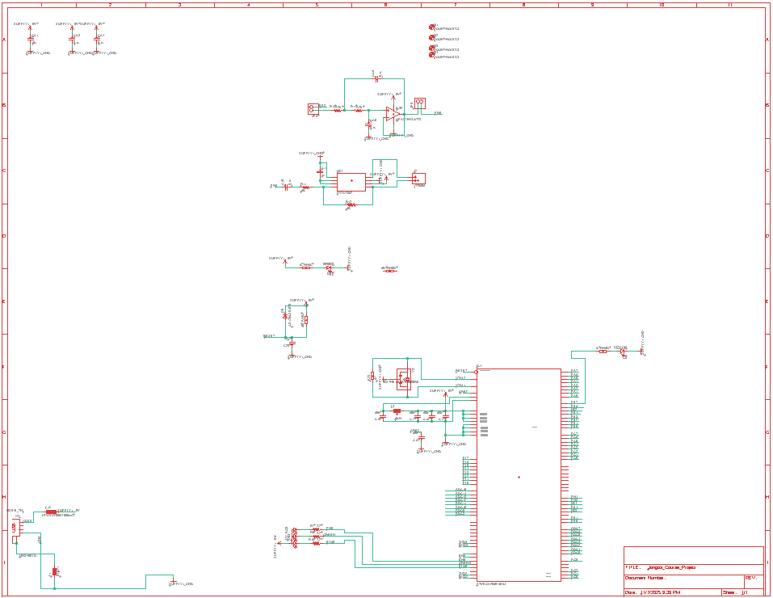
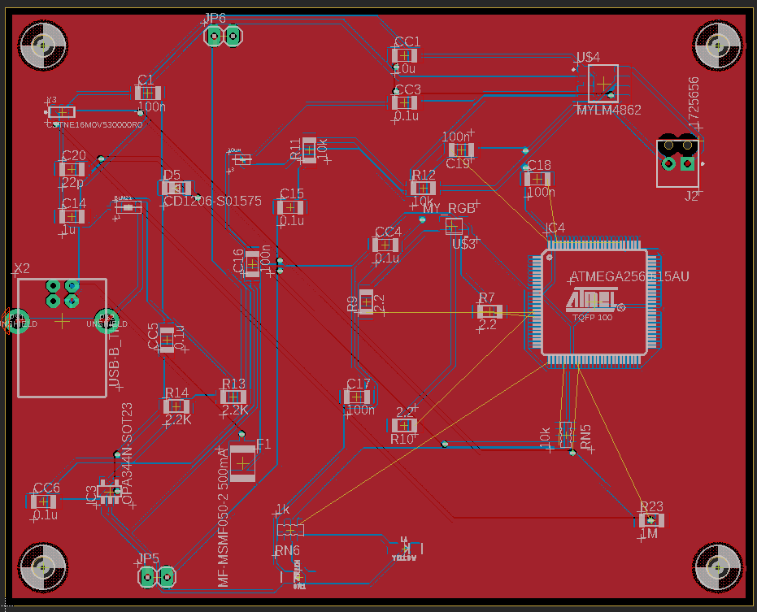

# Custom ATmega2560 Board (Eagle)

A 2-layer, 160 x 100 mm ATmega2560 board I designed in Eagle 9.6 as my
CE 351 course project at Fort Lewis College. The Gerber job file names
the project `Jangas_Course_Project`.

<p align="center">

&nbsp;

</p>

## What is on the board

From the pick-and-place file that goes with the Gerbers (`gerbers/PnP_top.txt`):

| Block | Part |
| --- | --- |
| MCU | ATmega2560 (TQFP-100) |
| Clock | 16 MHz ceramic resonator (CSTNE16M0V530000R0) |
| Regulator | AMS1117-5.0 |
| Audio | LM4862 audio amplifier |
| Other | reset/tactile switch, status LEDs, resistor networks, decoupling capacitors |

All parts are on the top side, so `PnP_bottom.txt` is empty.

## Files

```
custom-mega-pcb/
├── schematic/skyboard.sch, skyboard.brd   # Eagle design files
├── gerbers/                               # copper, mask, paste, silk, outline, drill, job file, pick-and-place
└── docs/
    ├── schematic.png                      # schematic of this board
    ├── layout.png                         # board layout of this board
    ├── layout_with_copper.png             # earlier CE 351 board (see note)
    ├── layout_traces_only.png             # earlier CE 351 board (see note)
    └── erc_clean.png                      # ERC window for the earlier board (see note)
```

## Limitations

- The `.sch`, `.brd` and Gerber files are not all from the same revision.
  The schematic also has a TB6612FNG motor driver and an ultrasonic-sensor
  header; the board file has a USB-B connector and an OPA344 op-amp; the
  Gerber pick-and-place adds the AMS1117 regulator.
- `docs/layout.png` still shows a few unrouted connections (yellow airwires).
- `layout_with_copper.png`, `layout_traces_only.png` and `erc_clean.png`
  show a different, earlier CE 351 board (an adjustable supply with an LED
  bar graph, built around an LT3080 and TLC274 op-amps). The ERC window in
  `erc_clean.png` lists 9 errors and 22 warnings for that board.
- The repo has no photo or test record of a fabricated copy of this board.
